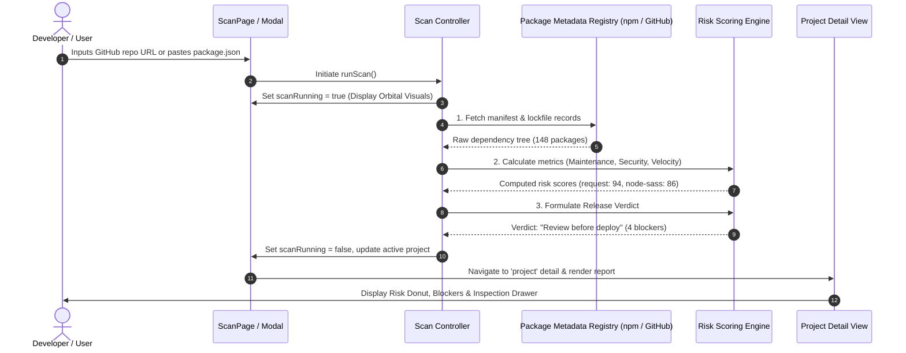
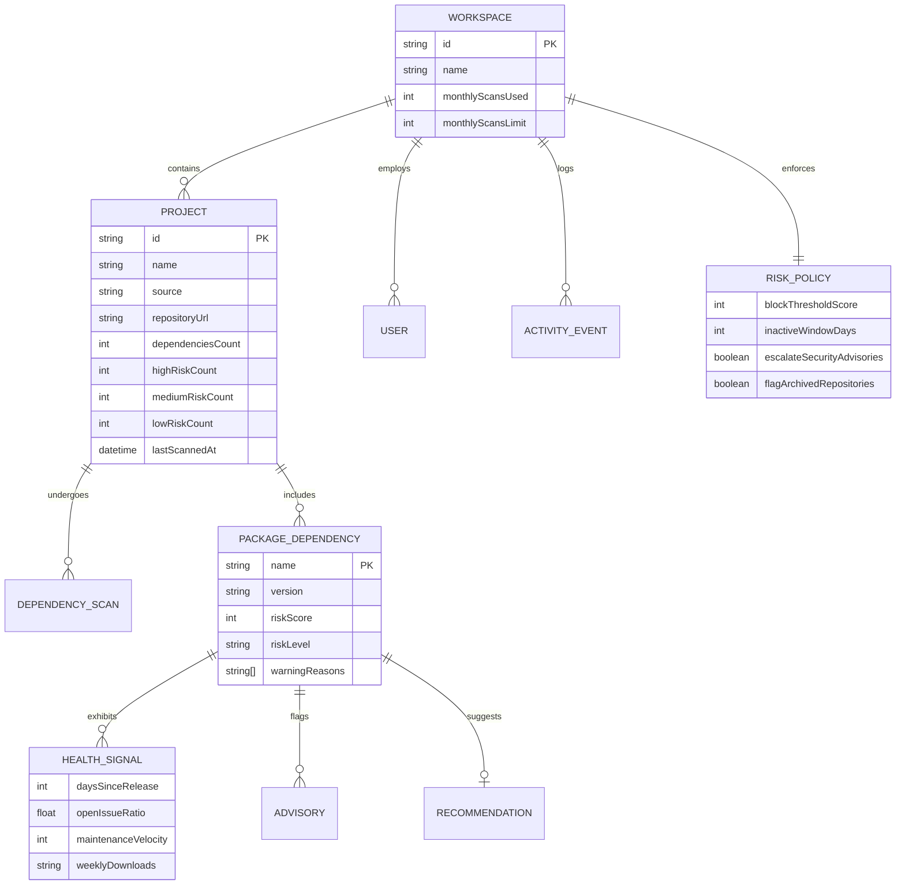

# DriftLogg: Architectural Blueprint & Codebase Analysis

## 1. System Architecture Overview

DriftLogg is designed as a software supply chain dependency preflight intelligence platform.

```mermaid
flowchart TD
    subgraph Client [Browser Client (React 19 + Vite)]
        Root[main.tsx: Root React Mount]
        App[App Shell & Router Controller]
        
        subgraph PublicLayer [Public Experience]
            HP[HomePage / Landing Experience]
            Auth[AuthPage: Login / Register]
        end
        
        subgraph WorkspaceLayer [Authenticated Workspace]
            Layout[AppLayout: Topbar + Sidebar Navigation]
            
            subgraph Views [Workspace Views]
                Dash[Overview Dashboard & Telemetry]
                ProjDir[Project Directory]
                ProjDetail[Project Detail & Dependency Grid]
                Scan[Scan Workbench & Processing Engine]
                Act[Activity Stream & Audit Log]
                Set[Settings & Risk Policy Config]
                Prof[User Profile & Security]
                Docs[Documentation & Guide]
            end
            
            subgraph Overlays [Inspectors & Dialogs]
                Drawer[Evidence Drawer: Package Signals & Migrations]
                Modal[Scan Modal: Repo & Manifest Ingestion]
            end
        end
    end

    subgraph ServiceLayer [Client State & Data Abstraction]
        State[Navigation & Workspace State]
        MockStore[Domain Data Stores: Projects, Packages, Telemetry]
    end

    Root --> App
    App --> PublicLayer
    App --> WorkspaceLayer
    WorkspaceLayer --> Layout
    Layout --> Views
    Views --> Overlays
    Views <--> State
    State <--> MockStore
```

---

## 2. Component Hierarchy & Data Flow

```mermaid
graph TD
    App[App Container]
    
    App -->|page === 'home'| HP[HomePage]
    HP --> PubHeader[PublicHeader]
    HP --> Hero[Hero Console Simulator]
    HP --> Problem[The Blind Spot Signals]
    HP --> Workflow[3-Step Preflight Track]
    HP --> PubFooter[PublicFooter]
    
    App -->|page === 'login' \| 'signup'| Auth[AuthPage]
    Auth --> BrandPanel[Auth Brand Panel]
    Auth --> AuthForm[Auth Form & OAuth Mock]
    
    App -->|Authenticated Workspace| Shell[AppShell]
    Shell --> Topbar[Topbar: Status + Actions + Avatar]
    Shell --> Sidebar[Sidebar: Nav Items + Usage Meter]
    
    Shell -->|page === 'dashboard'| DashView[Dashboard View]
    DashView --> ReadyPanel[Deployment Readiness Panel]
    DashView --> TelemPanel[Workspace Telemetry Panel]
    DashView --> RiskLanes[Risk Lanes: Search & Project Cards]
    
    Shell -->|page === 'projects'| ProjDir[Project Directory View]
    
    Shell -->|page === 'project'| ProjDetail[Project Detail View]
    ProjDetail --> ProjMeta[Scan Meta & Repository Header]
    ProjDetail --> DonutCard[Health Score & Donut Breakdown]
    ProjDetail --> DepTable[Dependencies Table & Filters]
    DepTable --> RiskBadge[RiskBadge Component]
    
    Shell -->|page === 'scan'| ScanPage[Scan Page]
    ScanPage --> ScanWork[Workbench: GitHub URL / Manifest Upload]
    ScanPage --> ScanProc[Processing Animation: 4 Orbit Stages]
    
    Shell -->|page === 'activity'| ActPage[Activity Stream]
    Shell -->|page === 'settings'| SetPage[Settings & Risk Policy]
    Shell -->|page === 'profile'| ProfPage[Profile & Security]
    Shell -->|page === 'docs'| DocsPage[Documentation]
    
    Shell --> InspectDrawer[Evidence Drawer: Signals & Recommendations]
    Shell --> ScanModal[Quick Scan Modal Dialog]
```

---

## 3. Dependency Scanning & Preflight Request Lifecycle



---

## 4. Entity-Relationship Model (Domain Architecture)



---

## 5. Technical Audit & Prioritized Findings

| Severity | Issue | Impact | Practical Solution |
| :--- | :--- | :--- | :--- |
| **Critical** | **Monolithic 2,170-line `App.tsx`** | Single point of failure; high risk of merge collisions; poor testability; forces complete re-render on tiny state changes. | Deconstruct into clean feature folders: `components/`, `features/`, `types/`, and `data/`. |
| **Critical** | **TypeScript Syntax Error in `Icon` definition** | `name: IconName size?: number` misses separator, causing `tsc` compilation failure. | Fix syntax to `{ name: IconName; size?: number }` and extract icons into dedicated components. |
| **High** | **Dual-Styling Drift (`index.css` vs Tailwind v4)** | 647 lines of hardcoded custom CSS bypass the Tailwind utility classes imported in Vite, duplicating declarations and complicating adjustments. | Structure CSS into modular layer files and leverage standard Tailwind v4 CSS variables. |
| **High** | **Coupled Presentation and Data** | Mock datasets (`projects`, `packages`, `events`) are hardcoded module-level constants in `App.tsx`. | Separate mock domain data and types into `src/data/` and `src/types/`. |
| **Medium** | **Inflexible Visualizations** | Donut chart in `Donut()` uses static SVG stroke-dasharray values regardless of project data. | Convert `Donut` to a dynamic SVG component accepting dynamic percentages/counts. |
| **Low** | **Navigation State Coupling** | Tab navigation is held entirely in memory; reload always drops the user back on `'home'`. | Provide clean navigation router abstraction with route history support. |

---

## 6. Proposed Clean Modular Architecture

```
src/
├── components/
│   ├── common/
│   │   ├── Icon.tsx                # Reusable SVG icon component with complete icon set
│   │   ├── Logo.tsx                # Brand logo mark & wordmark
│   │   ├── RiskBadge.tsx           # Risk tier indicator pill (High, Medium, Low)
│   │   └── DonutChart.tsx          # Dynamic SVG health composition donut chart
│   └── layout/
│       ├── AppShell.tsx            # Authenticated workspace layout shell
│       ├── Topbar.tsx              # Workspace top navigation header
│       ├── Sidebar.tsx             # Workspace persistent sidebar & usage meter
│       ├── PublicHeader.tsx        # Marketing site header
│       └── PublicFooter.tsx        # Marketing site footer
├── features/
│   ├── public/
│   │   ├── HomePage.tsx            # Marketing hero, problem grid, and interactive console
│   │   └── AuthPage.tsx            # Workspace login and signup workflows
│   ├── dashboard/
│   │   ├── OverviewDashboard.tsx   # Preflight readiness, workspace telemetry, and risk lanes
│   │   ├── ReadinessPanel.tsx      # Composite deployment readiness metric card
│   │   └── TelemetryPanel.tsx      # Aggregated workspace signal metrics
│   ├── projects/
│   │   ├── ProjectDirectory.tsx    # Monitored codebases priority table
│   │   ├── ProjectDetailView.tsx   # Project overview, breadcrumbs, and dependency table
│   │   └── DependenciesTable.tsx   # Filterable package table with score pills
│   ├── scan/
│   │   ├── ScanPage.tsx            # Full preflight scanning workbench
│   │   ├── ScanModal.tsx           # Quick scan modal dialog overlay
│   │   └── ScanProcessing.tsx      # Multi-stage orbital scanning animation
│   ├── activity/
│   │   └── ActivityPage.tsx        # Event timeline and signal summary
│   ├── settings/
│   │   └── SettingsPage.tsx        # Risk policy thresholds and workspace preferences
│   ├── profile/
│   │   └── ProfilePage.tsx         # User profile, role information, and security settings
│   ├── documentation/
│   │   └── DocumentationPage.tsx   # Quickstart guide and risk scale breakdown
│   └── drawer/
│       └── EvidenceDrawer.tsx      # Slide-out package deep inspection drawer
├── types/
│   ├── navigation.ts               # Page and route union types
│   ├── icons.ts                    # Supported icon identifiers
│   ├── project.ts                  # Project and repository domain models
│   ├── package.ts                  # Dependency, risk score, and health signal models
│   ├── activity.ts                 # Audit event and signal models
│   └── settings.ts                 # Risk policy and preference models
├── data/
│   ├── mockProjects.ts             # Initial repository datasets
│   ├── mockPackages.ts             # Initial package dependency datasets
│   └── mockEvents.ts               # Activity feed events
├── App.tsx                         # Clean root routing & workspace orchestrator (< 100 lines)
├── main.tsx                        # Entrypoint
└── index.css                       # Global styles & design tokens
```

