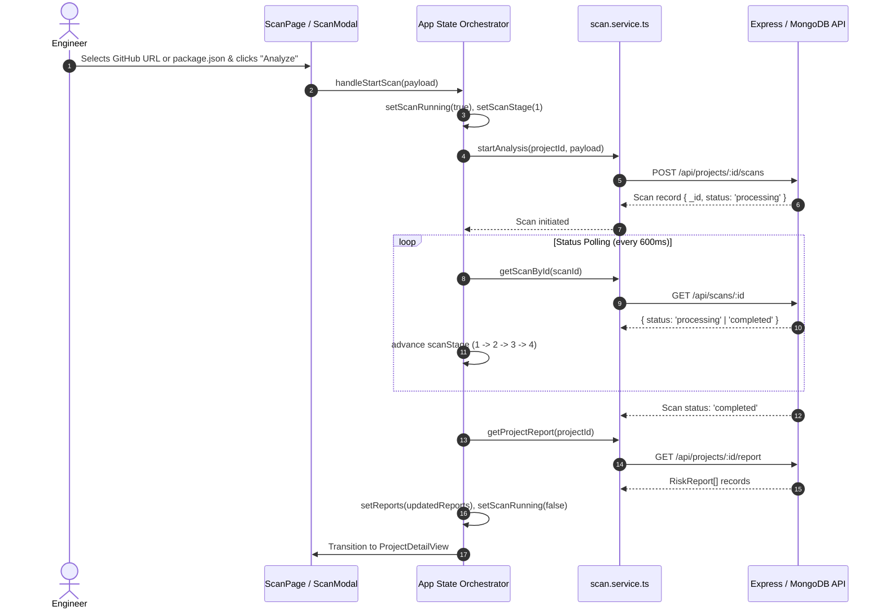

# DriftLogg: Comprehensive Technical Architecture & Developer Reference

## 1. Project Overview
**DriftLogg** is an engineering preflight and software supply chain dependency risk intelligence dashboard. It analyzes project manifests (`package.json`) and public repository signals (commit recency, issue velocity, release frequency, CVE advisories, maintainer status) to generate a composite **Deployment Readiness Verdict** (`Ready`, `Review`, or `Blocked`).

The application is structured to be 100% **contract-ready** for direct integration with an Express / MongoDB backend. All UI components interact through a strictly typed service layer with HTTP cookies enabled for JWT authentication.

---

## 2. Technology Stack & Environment
- **Framework:** React 19 (`react`, `react-dom` `^19.0.0`)
- **Language:** TypeScript 5.7 (Strict mode, `@/*` path mapping to `./src/*`)
- **HTTP Client:** Axios (`^1.7.0`) configured with `withCredentials: true`
- **Build Tool:** Vite 8.0.5 (`@vitejs/plugin-react`)
- **Styling:** Tailwind CSS v4 (`@tailwindcss/vite`) + Design system CSS tokens (`src/index.css`)
- **Formatter:** oxfmt (`^0.2.0`)
- **Platform:** Figma Make App

---

## 3. Directory Layout & Module Responsibilities

```
src/
├── components/
│   ├── common/                     # Reusable design system primitives
│   │   ├── DonutChart.tsx          # Dynamic SVG package health composition chart
│   │   ├── Icon.tsx                # Typed 16-glyph SVG icon dictionary
│   │   ├── Logo.tsx                # Brand mark and wordmark
│   │   └── RiskBadge.tsx           # High / Medium / Low severity status pill
│   ├── layout/                     # Persistent structural containers
│   │   ├── AppShell.tsx            # Authenticated workspace layout shell (with Admin guard)
│   │   ├── PublicFooter.tsx        # Marketing & legal footer
│   │   ├── PublicHeader.tsx        # Marketing navigation header
│   │   ├── Sidebar.tsx             # Workspace navigation drawer with scan usage tracker & Admin link
│   │   └── Topbar.tsx              # Workspace top bar with system status & avatar
│   └── overlays/                   # Modal and drawer layers
│       ├── EvidenceDrawer.tsx      # Package health signals & migration recommendation
│       └── ScanModal.tsx           # Quick repository / manifest ingestion modal
├── features/                       # Domain feature modules & route views
│   ├── activity/ActivityPage.tsx   # Activity stream & signal summary telemetry
│   ├── admin/AdminDashboard.tsx    # Superadmin audit, user management & global telemetry
│   ├── dashboard/OverviewDashboard.tsx # Deployment readiness, workspace telemetry, risk lanes
│   ├── documentation/DocumentationPage.tsx # Quickstart guide & score interpretation
│   ├── profile/ProfilePage.tsx     # User identity, workspace stats & 2FA security
│   ├── projects/
│   │   ├── ProjectDetailView.tsx   # Project overview, breadcrumbs, and dependency table
│   │   └── ProjectDirectory.tsx    # Monitored codebases priority matrix
│   ├── public/
│   │   ├── AuthPage.tsx            # Workspace login, registration & GitHub OAuth mock
│   │   └── HomePage.tsx            # Landing page hero, interactive console & value track
│   ├── scan/ScanPage.tsx           # Full scan workbench & live 4-stage orbital polling animation
│   └── settings/SettingsPage.tsx   # Deployment thresholds & risk policy controls
├── services/                       # Contract-ready API service layer
│   ├── apiClient.ts                # Axios instance with credentials, base URL & error interceptor
│   ├── auth.service.ts             # register, login, logout, getMe
│   ├── project.service.ts          # getProjects, getProjectById, createProject, deleteProject
│   ├── scan.service.ts             # startAnalysis, getScanById, getProjectScans, getProjectReport
│   ├── admin.service.ts            # getSystemStats, getAllUsers, getAllProjects
│   └── index.ts                    # Barrel export
├── types/                          # Frozen MongoDB & Domain TypeScript schemas
│   ├── user.ts                     # User schema (MongoDB _id, name, email, role, createdAt)
│   ├── project.ts                  # Project schema (MongoDB _id, sourceType, status, timestamps)
│   ├── scan.ts                     # Scan schema (queued, processing, completed, failed) & Dependency
│   ├── riskReport.ts               # RiskReport schema (signals, score, reasons, suggestions)
│   ├── package.ts                  # PackageDependency & HealthSignals
│   ├── navigation.ts               # Page routes union (including "admin")
│   ├── icons.ts                    # IconName
│   ├── activity.ts                 # ActivityEvent & ActivityTone
│   ├── settings.ts                 # RiskPolicySettings & SettingsSection
│   └── index.ts                    # Barrel export
├── App.tsx                         # Root router, service coordinator & polling orchestrator
├── index.css                       # Global CSS tokens, dark mode palette & utility layers
├── main.tsx                        # Application mount entrypoint
└── vite-env.d.ts                   # Vite client types
```

---

## 4. Contract Schemas & MongoDB Alignment

### User Schema (`User`)
```typescript
interface User {
  _id: string;
  name: string;
  email: string;
  role: 'user' | 'admin';
  createdAt: string;
}
```

### Project Schema (`Project`)
```typescript
interface Project {
  _id: string;
  name: string;
  description?: string;
  sourceType: 'package_json' | 'github_repo';
  repositoryUrl?: string;
  status: 'pending' | 'analyzing' | 'completed' | 'failed';
  createdAt: string;
  updatedAt: string;
}
```

### Scan Schema (`Scan`)
```typescript
interface Scan {
  _id: string;
  project: string;
  status: 'queued' | 'processing' | 'completed' | 'failed';
  startedAt: string;
  completedAt?: string;
  errorMessage?: string;
}
```

### RiskReport Schema (`RiskReport`)
```typescript
interface RiskReport {
  _id: string;
  scan: string;
  dependency: string;
  packageName: string;
  version: string;
  riskLevel: 'low' | 'medium' | 'high';
  riskScore: number;
  reasons: string[];
  signals: {
    lastCommit?: string;
    openIssues?: number;
    lastRelease?: string;
    weeklyDownloads?: number;
    deprecated?: boolean;
  };
  suggestion: string;
  createdAt: string;
}
```

---

## 5. Architectural Workflows & Lifecycle

### Dependency Scan & Polling Lifecycle


---

## 6. Development & Deployment Commands

```bash
# 1. Install dependencies (includes Axios)
npm install

# 2. Start development server
npm run dev

# 3. Type check with zero errors
npx tsc --noEmit

# 4. Production build
npm run build

# 5. Format source files
npx oxfmt src
```
